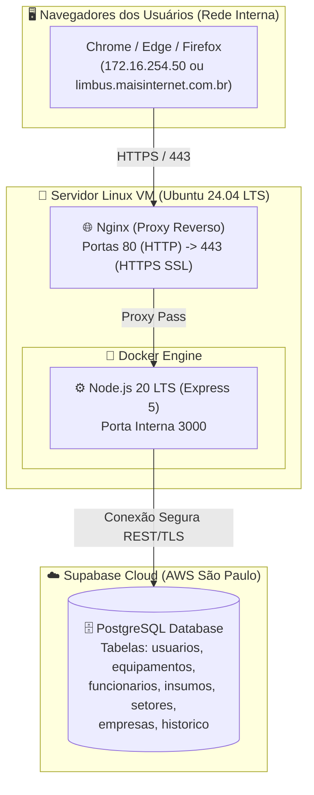

# Limbus — Sistema Corporativo de Gestão de Ativos & TI

<p align="center">
  
  <br>
  <strong>Plataforma Corporativa para Controle de Equipamentos, Insumos, Termos de Responsabilidade e Colaboradores</strong>
  <br>
  <em>Desenvolvido para alta disponibilidade, segurança de dados e integração em rede corporativa (24/7).</em>
</p>

---

## 📌 Sumário
- [Visão Geral](#-visão-geral)
- [Principais Funcionalidades](#-principais-funcionalidades)
- [Arquitetura & Stack Tecnológica](#-arquitetura--stack-tecnológica)
- [Estrutura do Projeto](#-estrutura-do-projeto)
- [Guia Rápido de Execução](#-guia-rápido-de-execução)
- [Variáveis de Ambiente](#-variáveis-de-ambiente)
- [API REST — Endpoints](#-api-rest--endpoints)
- [Documentação Completa](#-documentação-completa)
- [Licença e Autoria](#-licença-e-autoria)

---

## 🚀 Visão Geral

O **Limbus** é um sistema web completo desenvolvido para o departamento de Tecnologia da Informação (TI) gerenciar com precisão todo o ciclo de vida dos ativos tecnológicos da empresa:
* Cadastro de patrimônios, números de série e especificações técnicas de equipamentos.
* Controle de estoque de insumos de TI (mouses, teclados, cabos, fones, etc.).
* Alocação e controle de posse de dispositivos vinculados a funcionários.
* Geração automatizada de **Termos de Responsabilidade (Entrega e Devolução)** formatados para impressão em padrão A4.
* Histórico completo e imutável de todas as movimentações e desligamentos de colaboradores com justificativas.
* Autenticação corporativa protegida com sessões persistentes de 24 horas e controle de perfis de acesso.

---

## 🎯 Principais Funcionalidades

### 🔐 1. Autenticação & Gestão de Acessos
- Tela de login corporativa com design dark moderno.
- Sessão persistente por **24 horas (1 dia)** via token criptografado (`HMAC-SHA256`).
- Hash seguro de senhas com algoritmo `PBKDF2-SHA512` com salt único por usuário.
- Perfis de acesso:
  - **Administrador:** Acesso irrestrito a todos os módulos e gestão de operadores.
  - **Operador:** Acesso operacional completo (cadastro, movimentação, emissão de termos).
- Painel para administradores cadastrarem, editarem, ativarem/desativarem usuários e redefinirem senhas.

### 💻 2. Gestão de Equipamentos
- Cadastro com descrição, modelo/marca, número de patrimônio, serial number e observações.
- Status dinâmico (`DISPONIVEL` / `EM_USO`).
- Alocação direta para colaboradores ou emissão via gerador de termos.
- Filtros rápidos por status, busca em tempo real e ordenação.

### 📦 3. Insumos de TI & Estoque
- Controle quantitativo de periféricos e acessórios.
- Cálculo em tempo real: Quantidade Total, Quantidade em Uso (com colaboradores) e Saldo Disponível em Estoque.
- Entregas diretas de insumos a colaboradores com registro automático.

### 👥 4. Funcionários & Departamentos
- Cadastro individual ou **importação em massa via planilha Excel (`.xlsx`, `.xls`, `.csv`)**.
- Perfil detalhado do colaborador com listagem de todos os equipamentos e insumos em sua posse.
- Histórico individual de movimentações do colaborador.
- Desligamento de funcionários com justificativa obrigatória e desvinculação automática de itens para o estoque.
- Gestão centralizada de **Setores / Departamentos** com atualização em cascata.

### 📄 5. Emissão de Termos & Histórico
- Gerador de Termos de Entrega e Devolução integrado.
- Impressão otimizada em folha A4 com dados da empresa, colaborador e assinatura.
- Histórico geral auditável com filtros por período e botão de exportação/impressão de relatório.

---

## 🏗️ Arquitetura & Stack Tecnológica



- **Frontend:** HTML5 Semântico, Tailwind CSS (JIT Dark Mode), Vanilla JavaScript modular (ES6+), Lucide Icons, SheetJS (`xlsx`).
- **Backend:** Node.js 20 LTS, Express 5, CORS, Criptografia Nativa Node (`crypto`).
- **Banco de Dados:** PostgreSQL na nuvem via **Supabase Cloud** (Datacenter AWS São Paulo `sa-east-1`).
- **Infraestrutura & Deploy:** Docker, Docker Compose (com Live Volume Mount), Nginx (Proxy Reverso), OpenSSL com extensão SAN (HTTPS local).

---

## 📁 Estrutura do Projeto

```text
Limbus/
├── backend/
│   ├── auth.js                      # Criptografia, tokens de sessão e lógica de autenticação
│   ├── database.js                  # Conexão e cliente Supabase PostgreSQL
│   ├── server.js                    # API REST Express (Rotas, Validações, Middlewares)
│   ├── package.json                 # Dependências do backend
│   ├── .env.example                 # Exemplo de configuração de variáveis
│   ├── migrations/                  # Scripts SQL de criação de tabelas
│   │   └── 001_create_usuarios_table.sql
│   └── tests/                       # Suíte de testes automatizados (Jest + Supertest)
│       ├── api.test.js
│       └── auth.test.js
├── js/
│   ├── app.js                       # Roteador SPA, ciclo de vida e controle de tema
│   ├── auth.js                      # Controle de sessão, tokens e permissões no frontend
│   ├── store.js                     # Camada de comunicação com a API REST
│   ├── ui.js                        # Modais, alertas, toasts e utilitários visuais
│   ├── search.js                    # Command Palette e busca global (Ctrl + K)
│   ├── print.js                     # Layout e impressão de Termos de Responsabilidade
│   ├── utils.js                     # Formatadores (CPF, CNPJ, Datas, Moeda)
│   └── views/                       # Módulos de telas do sistema
│       ├── dashboard.js             # Indicadores e atividades recentes
│       ├── empresas.js              # Gestão de CNPJs e empresas
│       ├── equipamentos.js          # Gestão de ativos e alocação
│       ├── funcionarios.js          # Gestão e perfis de colaboradores
│       ├── insumos.js               # Gestão de insumos e saldo de estoque
│       ├── setores.js               # Gestão de departamentos
│       ├── historico.js             # Histórico e auditoria
│       ├── gerador.js               # Emissor de termos
│       └── usuarios.js              # Gestão administrativa de usuários
├── docs/                            # Documentação aprofundada
│   ├── DEPLOY_VM.md                 # Guia de implantação e configuração do servidor
│   ├── ARQUITETURA_E_SEGURANCA.md   # Detalhes de segurança, banco e sessão
│   └── MANUAL_DO_USUARIO.md         # Manual operacional para a equipe de TI
├── Dockerfile                       # Construção da imagem Docker de produção
├── docker-compose.yml               # Orquestração do container com live volume mount
├── index.html                       # Ponto de entrada do frontend SPA
├── styles.css                       # Estilização customizada e classes utilitárias
└── README.md                        # Este documento
```

---

## ⚡ Guia Rápido de Execução

### Opção A: Execução via Docker (Recomendado para Produção / VM)

1. Clone o repositório:
   ```bash
   git clone -b feature/corporate-deployment https://github.com/GuiZero777/Limbus.git
   cd Limbus
   ```
2. Crie o arquivo `backend/.env` com as credenciais do Supabase:
   ```bash
   cp backend/.env.example backend/.env
   nano backend/.env
   ```
3. Inicie o container:
   ```bash
   docker compose up -d
   ```
4. Acesse no navegador: **`http://localhost:3000`** (ou pelo IP da sua VM na rede).

---

### Opção B: Execução Local para Desenvolvimento (Node.js)

1. Entre na pasta do backend e instale as dependências:
   ```bash
   cd backend
   npm install
   ```
2. Inicie o servidor em modo de desenvolvimento:
   ```bash
   npm start
   ```
3. Execute a suíte de testes:
   ```bash
   npm test
   ```

---

## 🔑 Variáveis de Ambiente

Crie o arquivo `backend/.env` com a seguinte estrutura:

```env
# Chave mestra para assinatura de tokens de sessão
ADMIN_SECRET=sua_chave_secreta_jwt_longa_aqui

# Conexão com o Supabase Cloud
SUPABASE_URL=https://axlxclegbcqnjntexqta.supabase.co
SUPABASE_KEY=sua_chave_publica_ou_service_role_supabase
```

---

## 📡 API REST — Endpoints

### 🔐 Autenticação & Usuários
| Método | Rota | Descrição | Permissão |
| :--- | :--- | :--- | :--- |
| `POST` | `/api/auth/login` | Autentica usuário e retorna token (24h) | Público |
| `GET` | `/api/auth/me` | Retorna os dados do usuário autenticado | Logado |
| `POST` | `/api/auth/alterar-senha` | Altera a senha do próprio usuário logado | Logado |
| `GET` | `/api/usuarios` | Lista todos os operadores do sistema | Admin |
| `POST` | `/api/usuarios` | Cadastra um novo operador ou administrador | Admin |
| `PUT` | `/api/usuarios/:id` | Edita dados, status ou redefine senha | Admin |
| `DELETE` | `/api/usuarios/:id` | Remove ou desativa um usuário | Admin |

### 👥 Funcionários & Setores
| Método | Rota | Descrição |
| :--- | :--- | :--- |
| `GET` / `POST` | `/api/funcionarios` | Listagem e criação de colaboradores |
| `POST` | `/api/funcionarios/bulk` | Importação em massa via planilha Excel |
| `PUT` / `DELETE` | `/api/funcionarios/:id` | Edição e exclusão com motivo |
| `GET` / `POST` | `/api/setores` | Listagem e cadastro de setores |
| `PUT` / `DELETE` | `/api/setores/:name` | Renomeação ou exclusão em cascata |

### 💻 Equipamentos & Insumos
| Método | Rota | Descrição |
| :--- | :--- | :--- |
| `GET` / `POST` | `/api/equipamentos` | Listagem e cadastro de equipamentos |
| `PUT` / `DELETE` | `/api/equipamentos/:id` | Edição, alocação e exclusão |
| `GET` / `POST` | `/api/insumos` | Listagem e cadastro de modelos de insumos |
| `PUT` / `DELETE` | `/api/insumos/:id` | Edição e remoção de insumos |

### 🏢 Empresas & Histórico
| Método | Rota | Descrição |
| :--- | :--- | :--- |
| `GET` / `POST` | `/api/empresas` | Listagem e cadastro de empresas (CNPJ) |
| `DELETE` | `/api/empresas/:id` | Exclusão de empresa |
| `GET` / `POST` | `/api/historico` | Consulta de movimentações e registro de termos |
| `DELETE` | `/api/historico/:id` | Remoção de registro pontual do histórico |

---

## 📚 Documentação Completa

Para aprofundar nos procedimentos técnicos e manuais operacionais, consulte os guias na pasta `docs/`:

- 📖 **[Guia de Implantação no Servidor (VM / Nginx / SSL)](docs/DEPLOY_VM.md)**
- 🔒 **[Arquitetura, Banco de Dados & Segurança](docs/ARQUITETURA_E_SEGURANCA.md)**
- 📘 **[Manual de Operação do Sistema](docs/MANUAL_DO_USUARIO.md)**

---

## 👤 Autoria & Suporte

- **Desenvolvedor:** Guilherme Bardalho
- **Organização:** Mais Internet Telecom
- **Versão:** 2.1.0 Corporativa
