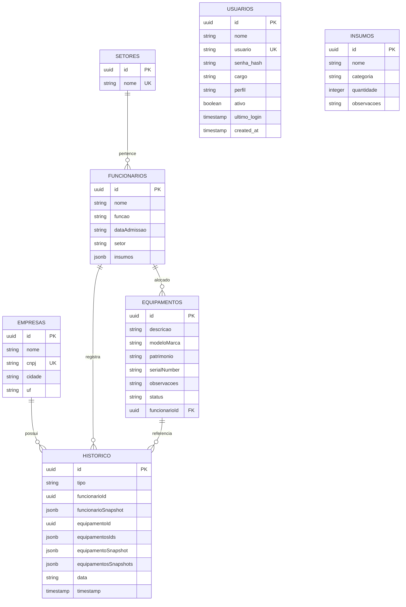

# Arquitetura, Banco de Dados & Segurança do Limbus

Este documento detalha o funcionamento interno, o modelo de dados relacional, as políticas de segurança e o sistema de autenticação do **Limbus**.

---

## 🏛️ 1. Arquitetura em Camadas

O Limbus foi projetado no padrão **Single Page Application (SPA)** desacoplado com API RESTful no backend:

```text
┌─────────────────────────────────────────────────────────────┐
│                    CAMADA DE APRESENTAÇÃO                   │
│   Vanilla JS Modular • Tailwind CSS JIT • Lucide Icons     │
│   Roteador SPA em Memória • Gerenciador de Sessão (Auth)    │
└──────────────────────────────┬──────────────────────────────┘
                               │ Requisições HTTP/JSON (Bearer Token)
                               ▼
┌─────────────────────────────────────────────────────────────┐
│                       CAMADA DE API                         │
│   Node.js 20 LTS • Express 5 REST API                       │
│   Middleware de Autenticação • Validação Estrita de Schemas │
│   Criptografia PBKDF2-SHA512 • Assinatura HMAC-SHA256       │
└──────────────────────────────┬──────────────────────────────┘
                               │ Conexão TLS Criptografada
                               ▼
┌─────────────────────────────────────────────────────────────┐
│                    CAMADA DE PERSISTÊNCIA                   │
│   PostgreSQL 15 (Supabase Cloud - Datacenter AWS São Paulo) │
│   Tabelas Relacionais • RLS (Row Level Security)            │
└─────────────────────────────────────────────────────────────┘
```

---

## 🔐 2. Sistema de Autenticação e Sessão (24 Horas)

A segurança do Limbus foi desenhada para equilibrar rigor corporativo e praticidade para o dia a dia da equipe de TI.

### 2.1. Criptografia de Senhas (PBKDF2-SHA512)
As senhas nunca são salvas em texto puro. O sistema utiliza derivação de chaves segura via módulo nativo `crypto` do Node.js:
1. Para cada usuário cadastrado ou alteração de senha, gera-se um `salt` aleatório de 16 bytes (32 caracteres hexadecimais).
2. Executa-se o algoritmo `PBKDF2` com **10.000 iterações** e função de hash `SHA-512`.
3. O hash final é armazenado no formato: `salt:hash`.
4. Durante a verificação no login, o hash informado é comparado em tempo constante com `crypto.timingSafeEqual` para prevenir ataques de temporização (*timing attacks*).

### 2.2. Token de Sessão Assinado (HMAC-SHA256)
Após o login com sucesso, o backend gera um token de sessão com estrutura:

$$\text{Token} = \text{base64url}(\text{Payload}) + "." + \text{HMAC-SHA256}(\text{base64url}(\text{Payload}), \text{SECRET})$$

**Payload do Token:**
```json
{
  "userId": "a0000000-0000-0000-0000-000000000001",
  "usuario": "guilherme",
  "nome": "Guilherme Bardalho",
  "perfil": "admin",
  "cargo": "TI",
  "exp": 1790274529488
}
```

- **Duração da Validade:** Exatamente **24 horas (86.400.000 ms)** a partir da emissão.
- **Validação:** A cada requisição à API, o backend verifica se a assinatura é autêntica e se a data atual é menor que `payload.exp`. Se expirado, retorna `401 Unauthorized`.
- **Armazenamento no Cliente:** O token é guardado no `localStorage` do navegador e anexado automaticamente em todas as chamadas no cabeçalho `Authorization: Bearer <token>`.

### 2.3. Perfis de Acesso
| Perfil | Permissões |
| :--- | :--- |
| **Administrador (`admin`)** | Acesso total: cadastros, movimentações, exclusões, emissão de termos e módulo de **Gestão de Usuários e Acessos** da equipe. |
| **Operador (`operador`)** | Acesso operacional: visualização, cadastros de equipamentos, insumos, colaboradores e emissão de termos. Não acessa gestão de usuários. |

---

## 🗄️ 3. Modelo Relacional de Dados (PostgreSQL no Supabase)

O banco de dados é hospedado no **Supabase Cloud** (PostgreSQL na região da América do Sul - São Paulo `sa-east-1`).



---

## 📜 4. Scripts SQL de Inicialização do Banco

Os comandos abaixo criam a estrutura completa do banco no Supabase:

```sql
-- 1. Tabela de Usuários do Sistema
CREATE TABLE IF NOT EXISTS public.usuarios (
    id UUID PRIMARY KEY DEFAULT gen_random_uuid(),
    nome TEXT NOT NULL,
    usuario TEXT UNIQUE NOT NULL,
    senha_hash TEXT NOT NULL,
    cargo TEXT DEFAULT 'Operador de TI',
    perfil TEXT DEFAULT 'operador',
    ativo BOOLEAN DEFAULT true,
    ultimo_login TIMESTAMP WITH TIME ZONE,
    created_at TIMESTAMP WITH TIME ZONE DEFAULT timezone('utc'::text, now()) NOT NULL
);

-- 2. Tabela de Empresas (CNPJs Geradores)
CREATE TABLE IF NOT EXISTS public.empresas (
    id UUID PRIMARY KEY DEFAULT gen_random_uuid(),
    nome TEXT NOT NULL,
    cnpj TEXT UNIQUE NOT NULL,
    cidade TEXT NOT NULL,
    uf TEXT NOT NULL
);

-- 3. Tabela de Setores
CREATE TABLE IF NOT EXISTS public.setores (
    id UUID PRIMARY KEY DEFAULT gen_random_uuid(),
    nome TEXT UNIQUE NOT NULL
);

-- 4. Tabela de Funcionários
CREATE TABLE IF NOT EXISTS public.funcionarios (
    id UUID PRIMARY KEY DEFAULT gen_random_uuid(),
    nome TEXT NOT NULL,
    funcao TEXT NOT NULL,
    "dataAdmissao" TEXT NOT NULL,
    setor TEXT,
    insumos JSONB DEFAULT '[]'::jsonb
);

-- 5. Tabela de Equipamentos
CREATE TABLE IF NOT EXISTS public.equipamentos (
    id UUID PRIMARY KEY DEFAULT gen_random_uuid(),
    descricao TEXT NOT NULL,
    "modeloMarca" TEXT NOT NULL,
    patrimonio TEXT,
    "serialNumber" TEXT,
    observacoes TEXT,
    status TEXT DEFAULT 'DISPONIVEL',
    "funcionarioId" UUID REFERENCES public.funcionarios(id) ON DELETE SET NULL
);

-- 6. Tabela de Insumos de TI
CREATE TABLE IF NOT EXISTS public.insumos (
    id UUID PRIMARY KEY DEFAULT gen_random_uuid(),
    nome TEXT NOT NULL,
    categoria TEXT,
    quantidade INTEGER DEFAULT 0,
    observacoes TEXT
);

-- 7. Tabela de Histórico de Movimentações
CREATE TABLE IF NOT EXISTS public.historico (
    id UUID PRIMARY KEY DEFAULT gen_random_uuid(),
    tipo TEXT NOT NULL,
    "funcionarioId" UUID,
    "funcionarioSnapshot" JSONB,
    "equipamentoId" UUID,
    "equipamentosIds" JSONB,
    "equipamentoSnapshot" JSONB,
    "equipamentosSnapshots" JSONB,
    data TEXT NOT NULL,
    timestamp TIMESTAMP WITH TIME ZONE DEFAULT timezone('utc'::text, now()) NOT NULL
);

-- Políticas de RLS (Row Level Security)
ALTER TABLE public.usuarios ENABLE ROW LEVEL SECURITY;
ALTER TABLE public.empresas ENABLE ROW LEVEL SECURITY;
ALTER TABLE public.funcionarios ENABLE ROW LEVEL SECURITY;
ALTER TABLE public.equipamentos ENABLE ROW LEVEL SECURITY;
ALTER TABLE public.insumos ENABLE ROW LEVEL SECURITY;
ALTER TABLE public.setores ENABLE ROW LEVEL SECURITY;
ALTER TABLE public.historico ENABLE ROW LEVEL SECURITY;

CREATE POLICY "Acesso total usuarios" ON public.usuarios FOR ALL USING (true) WITH CHECK (true);
CREATE POLICY "Acesso total empresas" ON public.empresas FOR ALL USING (true) WITH CHECK (true);
CREATE POLICY "Acesso total funcionarios" ON public.funcionarios FOR ALL USING (true) WITH CHECK (true);
CREATE POLICY "Acesso total equipamentos" ON public.equipamentos FOR ALL USING (true) WITH CHECK (true);
CREATE POLICY "Acesso total insumos" ON public.insumos FOR ALL USING (true) WITH CHECK (true);
CREATE POLICY "Acesso total setores" ON public.setores FOR ALL USING (true) WITH CHECK (true);
CREATE POLICY "Acesso total historico" ON public.historico FOR ALL USING (true) WITH CHECK (true);
```

---

## 🛡️ 5. Isolamento de Rede e Segurança Corporativa

1. **Intranet Blindada:** A VM do Limbus responde exclusivamente no endereço IP privado (`172.16.254.50`) e no domínio interno corporativo (`limbus.maisinternet.com.br`). Nenhuma porta está exposta publicamente para a internet, protegendo o sistema contra varreduras e acessos não autorizados.
2. **Criptografia em Trânsito:** Todo tráfego HTTP na porta 80 é redirecionado compulsoriamente via Nginx com status HTTP 301 para a porta HTTPS 443 criptografada com TLSv1.2 e TLSv1.3.
3. **Desvinculação Segura em Desligamentos:** Quando um colaborador é desligado do sistema, o Limbus automaticamente altera o status de todos os seus equipamentos para `DISPONIVEL` e grava no histórico o motivo do desligamento associado ao snapshot permanente.
