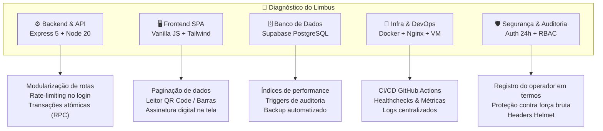
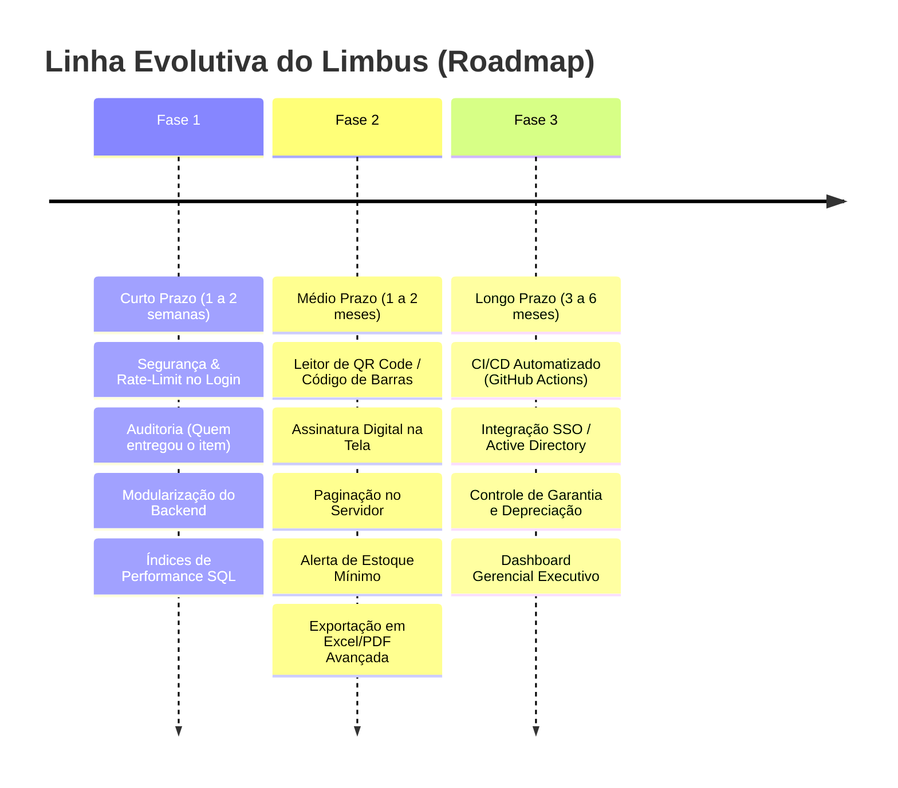

# 🚀 Relatório Estratégico de Revisão de Código & Plano de Evolução do Limbus

**Data da Revisão:** 28 de Setembro de 2026  
**Sistema:** Limbus (Gestão Corporativa de Ativos, Insumos e Termos de TI)  
**Versão Atual:** 2.1.0 (Produção na VM Linux Ubuntu)

---

## 🧭 Sumário Executivo

O **Limbus** atingiu com sucesso o estágio de **aplicação de produção corporativa**:
- Containerizado com **Docker**, operando 24/7 em VM Ubuntu interna (`172.16.254.50`).
- Tráfego protegido por **Nginx com HTTPS/SSL** e suporte ao domínio `limbus.maisinternet.com.br`.
- Banco de dados relacional em nuvem no **Supabase PostgreSQL** na região de São Paulo (`sa-east-1`).
- Autenticação corporativa com **PBKDF2-SHA512**, tokens assinados de 24h e gestão de operadores.
- Suíte automatizada de **61 testes unitários** passando com 100% de sucesso.

Para transformar o Limbus em uma **plataforma empresarial de referência em gestão de TI (ITAM - IT Asset Management)**, realizamos uma auditoria 360° em todas as camadas e traçamos uma **linha progressiva de crescimento (Roadmap)** dividida em 3 fases estratégicas.

---

## 🔍 1. Diagnóstico Técnico & Pontos de Melhoria (Auditoria 360°)

---

### 1.1. Backend & API (Node.js / Express)

| Situação Atual | Oportunidade de Melhoria | Impacto / Benefício |
| :--- | :--- | :--- |
| **Arquivo `server.js` monolítico** (~780 linhas). | Quebrar em estrutura modular: `routes/`, `controllers/`, `middlewares/` e `validators/`. | **Manutenibilidade:** Código muito mais limpo, fácil de estender e testar sem risco de regressão. |
| **Operações de movimentação em múltiplas etapas separadas.** | Na entrega/devolução, o backend atualiza o equipamento e depois insere o histórico. Se houver falha de rede na segunda chamada, pode haver inconsistência. Implementar **transação única no banco** ou endpoint com rollback. | **Consistência:** Garantia de atomicidade (ACID) em qualquer falha de rede. |
| **Falta de Rate Limiting no Login.** | Adicionar `express-rate-limit` na rota `POST /api/auth/login` (ex: máx. 5 tentativas por minuto por IP). | **Segurança:** Bloqueia tentativas automatizadas de força bruta de senhas. |
| **Headers de Segurança HTTP.** | Instalar o middleware `helmet` para aplicar políticas modernas de CSP, HSTS e proteção contra clickjacking. | **Conformidade:** Eleva o rating de segurança corporativa do servidor. |

---

### 1.2. Frontend & Experiência do Usuário (SPA)

| Situação Atual | Oportunidade de Melhoria | Impacto / Benefício |
| :--- | :--- | :--- |
| **`initializeStore()` carrega todos os dados de uma vez na memória.** | Funciona com excelência até milhares de registros. Quando a empresa atingir dezenas de milhares de itens/históricos, carregar tudo no início aumentará o tempo de abertura. Implementar **paginação no backend** (`LIMIT` e `OFFSET`) com busca remota. | **Escalabilidade:** Tempo de carregamento inferior a 200ms independente do tamanho da empresa. |
| **Impressão física tradicional de termos.** | Permitir **Assinatura Digital no Navegador** (com dedo ou caneta em touchscreen/tablet) e envio automático do PDF assinado por e-mail/WhatsApp. | **Agilidade & Sustentabilidade:** Elimina uso de papel e arquivamento físico de fichas de EPI/TI. |
| **Digitação manual de patrimônios e seriais.** | Adicionar **Leitor de Código de Barras / QR Code** via câmera do celular ou leitor USB na tela de cadastro e busca rápida. | **Produtividade:** Inventários e conferências de equipamentos 5x mais rápidos. |
| **Ausência de Alertas Visuais de Estoque Crítico.** | No módulo de Insumos, exibir alertas automáticos quando o saldo de mouses/teclados atingir o estoque mínimo definido (ex: menos de 5 unidades). | **Prevenção:** Evita ficar sem insumos básicos no dia a dia da TI. |

---

### 1.3. Banco de Dados & Supabase PostgreSQL

| Situação Atual | Oportunidade de Melhoria | Impacto / Benefício |
| :--- | :--- | :--- |
| **Tabelas sem índices secundários explícitos.** | Criar índices em colunas frequentemente consultadas: `equipamentos(status)`, `equipamentos(funcionarioId)`, `funcionarios(setor)`, `historico(funcionarioId)`. | **Velocidade:** Consultas e filtros instantâneos mesmo com grande volume de dados. |
| **Histórico armazena o funcionário, mas não quem realizou a ação.** | Adicionar o campo `operador_id` / `operador_nome` na tabela `historico`. | **Auditoria e Compliance:** Saber com precisão qual membro da equipe de TI emitiu cada termo ou realizou cada devolução. |
| **Rotina de Backup Independente.** | Criar um script automatizado (`cron`) na VM para gerar um dump diário comprimido do banco PostgreSQL e salvar localmente/nuvem. | **Resiliência:** Garantia de recuperação em desastres independente do painel do Supabase. |

---

### 1.4. Infraestrutura, DevOps & Deploy

| Situação Atual | Oportunidade de Melhoria | Impacto / Benefício |
| :--- | :--- | :--- |
| **Deploy manual via `git pull` na VM.** | Criar um workflow de **GitHub Actions** (CI/CD) que roda os testes e atualiza a VM automaticamente a cada `git push` na branch principal. | **Automação:** Zero comandos manuais no terminal da VM após aprovação de código. |
| **Falta de monitoramento de integridade (Healthcheck).** | Adicionar endpoint `/api/health` e configuração de `healthcheck` no `docker-compose.yml` para autorestart do container em caso de falha. | **Alta Disponibilidade:** Recuperação automática de falhas sem intervenção humana. |

---

## 📈 2. Linha Tênue de Crescimento (Roadmap em 3 Fases)

Para evoluir o sistema de forma sustentável e sem interromper o uso diário da empresa, estruturamos o crescimento em **3 Fases**:

---

### 🟢 FASE 1: Estabilização, Segurança & Auditoria (Curto Prazo — 1 a 2 semanas)
*Objetivo: Blindar o sistema, organizar a arquitetura e enriquecer a rastreabilidade.*

1. **Rastreabilidade Total no Histórico:**
   - Gravar o nome do operador de TI logado em cada movimentação (Entrega, Devolução, Desligamento).
2. **Camada de Proteção de Acesso:**
   - Adicionar proteção contra força bruta no login (`rate-limit`) e headers de segurança (`helmet`).
3. **Modularização do Backend:**
   - Organizar o código em pastas claras (`routes/`, `controllers/`, `middlewares/`) para facilitar a adição de novas funcionalidades.
4. **Otimização de Índices no PostgreSQL:**
   - Executar comandos de indexação no Supabase para garantir máxima performance de busca.

---

### 🟡 FASE 2: Recursos Operacionais & Produtividade da TI (Médio Prazo — 1 a 2 meses)
*Objetivo: Reduzir tempo operacional e eliminar totalmente o papel e o retrabalho.*

1. **Leitor de Código de Barras / QR Code:**
   - Adicionar botão de câmera ou suporte a leitor óptico para ler a etiqueta de patrimônio instantaneamente no cadastro e na entrega.
2. **Assinatura Digital de Termos:**
   - O colaborador assina o termo de recebimento direto na tela do celular/tablet ou computador da TI.
3. **Alertas Inteligentes de Estoque:**
   - Indicador visual e aviso na tela quando mouses, fones ou cabos estiverem abaixo do nível mínimo.
4. **Exportação Avançada de Relatórios:**
   - Relatório consolidado em PDF e Excel por setor, por empresa ou por status de equipamento para auditoria contábil.
5. **Paginação Inteligente na API:**
   - Suporte a rolagem infinita ou paginação rápida no servidor para empresas com milhares de colaboradores.

---

### 🔵 FASE 3: Automação Corporativa & Inteligência (Longo Prazo — 3 a 6 meses)
*Objetivo: Integrar o Limbus ao ecossistema corporativo completo da empresa.*

1. **Integração com Active Directory / LDAP / Google Workspace:**
   - Login único (SSO) com as credenciais corporativas do colaborador.
2. **Controle de Ciclo de Vida e Garantia de Ativos:**
   - Registro de data de compra, fim de garantia e valor residual/depreciação de notebooks e servidores.
3. **Deploy Automatizado (CI/CD via GitHub Actions):**
   - Publicação automática na VM assim que o código for aprovado no repositório.
4. **Módulo de Chamados/Manutenções:**
   - Histórico de manutenções de hardware (troca de SSD, upgrade de memória, reparo em garantia).

---

## 🎯 Próximo Passo Recomendado

Para iniciar a execução dessa linha de crescimento, a recomendação técnica imediata é focar nos itens da **Fase 1**:
1. **Adicionar o registro do operador de TI no histórico de entregas/devoluções.**
2. **Adicionar o rate-limiting de segurança no login e headers de proteção.**
3. **Criar os índices no Supabase para garantir velocidade máxima.**

Essa base deixará o Limbus com padrão de software corporativo de grande porte, pronto para receber os recursos visuais de QR Code e assinatura digital na sequência!
